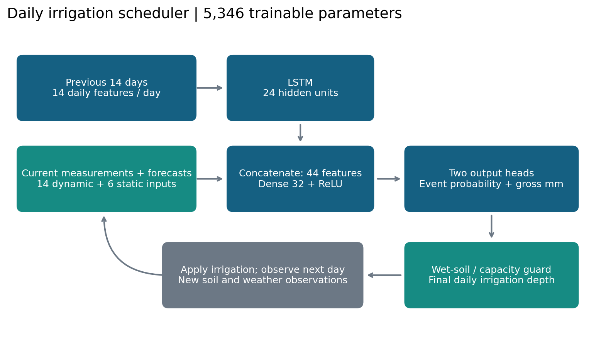

# Proposed response: daily irrigation scheduling with an LSTM

**Scope of the supporting work.** I implemented and tested the approach using
synthetic farms and weather because measured farm records were not available.
These experiments demonstrate the method and its limitations; they do not
establish performance on real farms. All numerical results below are from the
included code, averaged over three training seeds.

## (a) Training approach, sketch, inputs and outputs

I would make an irrigation decision each morning and update it throughout April 1
to May 30, rather than prepare a fixed schedule for all 60 days. The decision is
whether to irrigate that day and how much water to apply. I would treat different
soil or irrigation zones separately when a farm is not reasonably uniform.

The main physical quantity is the water available within the roots. The amount
that can be stored depends on field capacity, wilting point and rooting depth:

**TAW = 1000 × (field capacity − wilting point) × root depth**, in millimetres.

This allows the model to distinguish a shallow-rooted young crop on sandy soil
from a more developed crop in a soil with greater storage. Root depth and crop
water demand should change as the corn develops.

The implemented model uses the following inputs. Daily weather summaries refer
to the preceding 24 hours, so they are available when the decision is made.

| Inputs | Parameters and units |
|---|---|
| Recent weather | Rainfall (mm), minimum and maximum temperature (°C), relative humidity (%), wind (m/s) and solar radiation (MJ/m²/day) |
| Current water status | Root-zone soil moisture (m³/m³) and the fraction of available soil water already depleted |
| Forecast | Reference evapotranspiration for the coming day (mm/day) and rainfall expected before the next daily decision (mm) |
| Crop | Days since planting, estimated rooting depth (m) and growth-dependent crop coefficient |
| Irrigation history | Previous day's actual gross irrigation depth (mm), retained across the historical input sequence |
| Farm properties | Field capacity, wilting point, infiltration capacity (mm/day), irrigation efficiency, maximum daily gross irrigation (mm/day) and runoff fraction |

In a real installation, I would measure moisture at several depths and locations,
calculate reference evapotranspiration from weather using an established method
such as FAO-56 Penman–Monteith, and document the planting date, cultivar, soil
profile and equipment. Soil temperature, ponding, groundwater and sensor-quality
information would help identify situations needing additional safeguards. These
additional channels are field-study requirements, not features already tested
in the simplified implementation.

For the baseline experiment, the LSTM receives 14 previous days, each containing
14 dynamic features. A 24-unit LSTM summarizes this history. Its output is combined
with the current 14 features and six farm properties, then passed through a
32-unit layer. The two final outputs are irrigation probability and conditional
gross depth in millimetres. A probability of at least 0.5 triggers the predicted
depth; otherwise the recommendation is zero. Application rate converts gross
depth to hours of operation.

I also apply practical limits: no irrigation when measured soil is already wet,
no application exceeding the observed storage deficit after correcting for
efficiency, and no application beyond equipment capacity. These checks support
the model but cannot compensate for faulty sensors or incorrect soil properties.

Training requires a trustworthy daily irrigation decision and amount. Historical
farmer actions should be checked because they are not automatically optimal. In
the experiment, an explicit water-balance rule supplies the labels. The LSTM is
therefore learning to imitate that rule. It is trained with a classification loss
for the yes/no decision and a regression loss for the amount on irrigation days.
I reserve whole seasons for validation and testing, fit scaling on training data
only, and use early stopping. Future observed weather is never supplied as if it
were an available forecast.

## (b) How much past data is needed?

The input history and the training dataset are different requirements. The
baseline uses 14 previous days per decision, but I also tested 7 and 30 days.
Their held-out errors were 0.620, 0.548 and 0.493 mm/day for 7, 14 and 30 days,
respectively. These comparisons show that history length should be evaluated;
they do not establish that one particular length is always required.

I then trained on one, three and six synthetic seasons from each of eight farms.
That provided 480, 1,440 and 2,880 daily training decisions. The corresponding
errors were 1.056, 0.794 and 0.548 mm/day. More data helped in this experiment,
but there is no basis for claiming that six years guarantees reliable field
performance. Only 55 of the 960 source test days required irrigation under the
teacher, so counting total days alone would overstate the information available.

For real farms, I would seek multiple seasons representing wet and dry conditions,
enough irrigation events, and the relevant soil and equipment settings. I would
judge sufficiency from learning curves and errors on unseen farms and seasons.
With limited data, a calibrated water-balance scheduler or simpler model may be
more defensible. In fact, the current-state MLP had lower source prediction error
than the LSTM here, so these experiments do not prove that recurrent memory is
necessary when current soil moisture is measured well.

## (c) Transfer to another farm

I would first supply the new farm's soil, crop and equipment properties, then
check the unchanged model against local observations. I would keep its original
normalization and initially fine-tune only the final layers. If enough local
records were available and validation showed a benefit, I would also fine-tune
the LSTM with a smaller learning rate. The final evaluation would use a separate
local season, not the adaptation records.

I tested this with two farms excluded from source training. Each had 120 local
training days, 60 validation days and 120 separate test days. Head-only adaptation
changed the first farm's prediction error from 1.111 to 1.040 mm/day. However, it
worsened the second farm's error from 0.504 to 1.272 mm/day. Transfer learning is
therefore an option to validate, not an automatic improvement. I would retain
the unchanged model when local validation does not support updating it.

I would also check the consequences of the recommendations over time. A small
one-day prediction error does not necessarily imply a good irrigation policy,
because today's irrigation changes tomorrow's soil moisture.

## (d) Excessive rain on May 1

The previously trained LSTM can still be used if the changed conditions remain
within what it can represent. A storm changes the state of the farm; it does
not automatically invalidate the model weights.

I would update rainfall, measured soil moisture and the forecast, then calculate
a new recommendation. Irrigation should remain off while the root zone is wet.
The model uses a fresh input window each morning, so the new observations enter
without retraining. Some rainfall may run off or drain below the roots; I would
not simply subtract all rainfall from a previously planned irrigation amount.

In the experiment, an unforecast 80 mm event occurred before the May 1 morning
decision. The ordinary-trained LSTM recommended zero irrigation that day in all
evaluated rollouts, with no weight updates during May. Across source farms, May
irrigation averaged 41.938 mm when the recommendations were updated daily,
compared with 71.607 mm when the ordinary-weather schedule was blindly replayed.
This illustrates why the schedule must respond to observations. It is not a
comparison against a competent farmer or an updated water-balance scheduler.

If the storm caused prolonged flooding, damaged drainage or injured the crop, I
would not assume that this simple model remained adequate. I would use measured
conditions and a suitable fallback, update the farm-state description, and
retrain or fine-tune only after enough relevant verified data became available.
If rain starts after the morning decision, an independent rain sensor should
stop irrigation; a once-daily model cannot react to an event it has not observed.

## (e) Training for sudden changes

I would include different weather regimes and the recovery periods after major
events, rather than train only on average conditions. When rare events are scarce,
a calibrated process model could generate physically consistent supplementary
examples. I would also test forecast errors and sensor failures and hold out
entire extreme-event periods for evaluation. Sensor failures and persistent
flooding are proposed extensions, not experiments completed in this repository.

I tested one form of extreme-event augmentation: half the training trajectories
contained two unforecast heavy-rain events, while the total training-set size was
kept unchanged. This did not improve storm-test prediction error; it was 0.521
mm/day compared with 0.370 mm/day for ordinary training. In this simple setting,
current moisture observations already captured much of the storm's effect.
Therefore, I would evaluate whether augmentation actually helps the intended
failure cases instead of assuming that adding extreme events is sufficient.

For operation, I would combine daily measurement updates, practical irrigation
limits, monitoring of out-of-range inputs, and periodic retraining when verified
errors show that the learned relationship has changed. These are separate tasks:
updating observations handles an immediate change, while retraining addresses a
lasting mismatch between the model and the farm.

## References and evidence

Allen, R.G., Pereira, L.S., Raes, D., and Smith, M. (1998). *Crop evapotranspiration:
Guidelines for computing crop water requirements.* FAO Irrigation and Drainage
Paper 56. [Soil-water balance](https://www.fao.org/4/X0490E/x0490e0e.htm) and
[reference evapotranspiration](https://www.fao.org/4/X0490E/x0490e08.htm).

Hochreiter, S., and Schmidhuber, J. (1997). Long short-term memory. *Neural
Computation*, 9(8), 1735–1780. https://doi.org/10.1162/neco.1997.9.8.1735.

All experimental numbers are generated by this repository, not taken from these
references. See `results/prediction_metrics.csv`, `results/rollout_metrics.csv`,
the per-day outputs and the saved checkpoints for supporting evidence.
